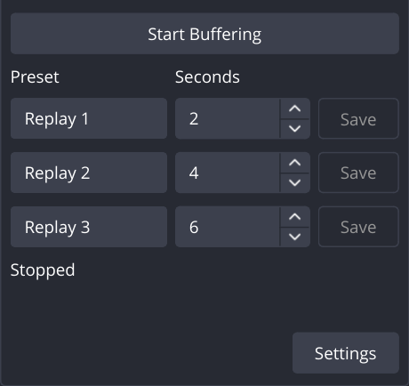

# OBS Multi Replay Buffer

Save several replay lengths from one encoded memory buffer in OBS Studio, with a separate save button and hotkey for each preset.

[](https://github.com/DinoRex4848/OBS-Multi-Replay-Buffer/actions/workflows/build.yml)
[User guide](docs/USER_GUIDE.md) · [Build from source](docs/DEVELOPMENT.md) · [Validation and limitations](docs/VALIDATION.md) · [Changelog](CHANGELOG.md)

**Experimental — source code only.** There is no published release or ready-to-use installer yet. Build and packaging scripts are included for developers; files generated locally or by CI are development artifacts, not supported releases. The source currently identifies itself as version `0.1.0`.

<p align="center">
  
</p>

*The dock with customized 2, 4, and 6 second presets. New profiles start with 60, 240, and 600 seconds.*

## What you can do

- Keep three editable replay lengths ready at once: one minute, four minutes, and ten minutes by default.
- Save each preset with its own button or OBS hotkey, including while the dock is hidden.
- Share OBS's recording encoders by default, or choose separate replay encoders when recording and replay need to run independently.
- Preserve selected audio tracks and save directly to MKV without re-encoding the replay or first writing a longer recording.
- Use OBS's recording folder, one shared destination, or a separate folder for each preset.
- Set a replay RAM budget, see live diagnostics, and save clearly labeled partial clips while the buffer warms up or under memory pressure.
- Use OBS's filename format and replay prefix/suffix, with collision handling that preserves existing files.

## Current platform status

| Platform | Status | Build environment |
| --- | --- | --- |
| Linux x86_64, Flatpak OBS | Latest local build and runtime testing targets OBS 32.2.2 | Matching Freedesktop 25.08 SDK; OBS-provided Qt 6 and FFmpeg 8 |
| Linux x86_64, Fedora RPM OBS | Historical runtime testing on Fedora 44 with OBS 32.1.1; Fedora build CI included | OBS/Qt development packages and FFmpeg 8 |
| Windows x64 | Build scripts and CI included; native Windows OBS runtime acceptance is still outstanding | Visual Studio 2022 and the OBS 32.1.1 SDK |

The plugin checks for OBS **32.1 or newer**, but that is not a guarantee of compatibility with every newer version. NVIDIA AV1, H.264, and HEVC with SDR and multiple FLAC tracks have the strongest Linux evidence. Other platforms, encoders, and recording modes need further testing. Read the [validation summary](docs/VALIDATION.md) for what was actually exercised.

## Make your first replay

After building and installing the plugin for your OBS installation:

1. Choose your recording encoder, quality, audio tracks, and recording folder in OBS Settings.
2. Open **Docks → Multi-Length Replay**. This is the plugin's current name inside OBS.
3. Open **Tools → Multi-Buffer Settings**, or click **Settings** in the dock. New profiles use a **6 GB decimal** replay budget and share recording encoders. Apply your changes.
4. Adjust the three preset names and durations, then click **Start Buffering**.
5. Click a preset's **Save** button, or assign its shortcut under **OBS Settings → Hotkeys**. Saves become available once playable history exists; early saves can be shorter than requested.
6. Click **Stop Buffering** to stop collecting and finish accepted saves.

Sharing also shares recording pauses: replay collects nothing while the recording is paused, and paused time is removed from the saved timeline. Select **Use separate replay encoder** if replay should continue through recording pauses. This adds encoding work when recording and replay run together.

See the [user guide](docs/USER_GUIDE.md) for save folders, hotkeys, clip boundaries, settings, and troubleshooting. OBS's built-in replay buffer must be stopped while using this plugin.

## Build from source

Clone this repository, then follow the instructions for your OBS installation:

```bash
git clone https://github.com/DinoRex4848/OBS-Multi-Replay-Buffer.git
cd OBS-Multi-Replay-Buffer
```

- **Flatpak OBS:** install its matching SDK and run `./scripts/build-flatpak.sh`.
- **Fedora RPM OBS:** install the native development packages, or build with rootless Podman.
- **Windows:** install the C++ build tools and run `./scripts/build-windows.ps1` in PowerShell.

The [development guide](docs/DEVELOPMENT.md) includes prerequisites, complete commands, developer installation instructions, and tests. Flatpak and RPM builds use different library environments and are not interchangeable. Compiled plugins, dependencies, and recordings are kept out of Git.

## Feedback and license

Use [Issues](https://github.com/DinoRex4848/OBS-Multi-Replay-Buffer/issues) for bugs and suggestions. Include the commit or plugin version, operating system, OBS version and installation type, encoder mode, and steps to reproduce. Include the relevant Diagnostics message or OBS log excerpt after removing personal paths and private information.

OBS Multi Replay Buffer is licensed under [GNU GPL v2.0 or later](LICENSE). Dependencies retain their own licenses; see [third-party notes](docs/THIRD_PARTY.md). This is an independent plugin project and is not an official OBS Studio component.

## AI assistance

OBS Multi Replay Buffer was made with substantial assistance from ChatGPT and OpenAI Codex, including help writing and debugging code, developing tests, and preparing documentation. I'm still learning to code, and I want to be transparent that this project reflects that collaboration.
